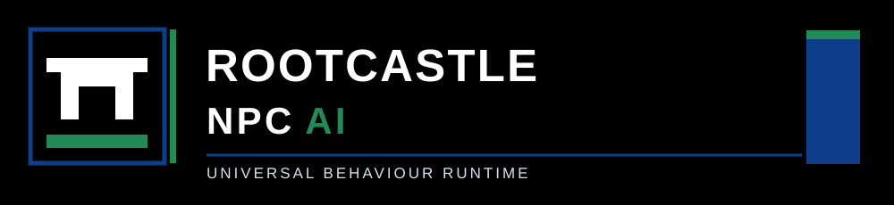

<p align="center">
  
</p>

<p align="center">
  <strong>A portable, deterministic NPC behaviour runtime.</strong><br />
  Decisions in. Engine tasks out. No engine ownership.
</p>

<p align="center">
  <a href="https://github.com/rootcastleco/Npc-ai/actions/workflows/ci.yml"></a>
  <a href="LICENSE"></a>
  
  
</p>

# Rootcastle NPC AI

A small, inspectable C++20 library for simulated characters in games, virtual worlds, training environments and custom engines. It decides *what an actor should do*, exposes the decision as a task command, and lets the host engine determine *how to move, animate, shoot, navigate, perceive, or interact*.

It includes an event-driven sensory model, faction disposition, time-limited memory, configurable personality, deterministic utility scoring, decision hysteresis, wandering, patrol, investigation, flight, engagement, assistance, a bounded task-hook pipeline, an engine task bridge, and a versioned C ABI for FFI users. The whole runtime is local: no accounts, online service, AI model downloads, third-party dependencies, or telemetry.

> **Status: v0.1.0 (initial public SDK).** This is a behaviour-selection runtime, not a physics engine, built-in pathfinder, animation system, LLM, or finished Unity/Unreal/Godot plugin. Host adapters must supply verified observations, navigation, motion and side effects. Deterministic replay is intended for a fixed build/platform/float environment; networked lockstep across architectures is not yet guaranteed.

## Architecture

```text
HOST GAME / ENGINE
  sensors + raycasts + combat events + transforms
              |
              v
     +---------------------+
     | sensory event input |   bounded per-actor inbox
     +----------+----------+
                |
                v
     +---------------------+
     | perception filter   |   hearing radius, vision cone, LOS contract
     +----------+----------+
                |
                v
     +---------------------+
     | memory / relations  |   TTL, salience, source refresh, factions
     +----------+----------+
                |
                v
     +---------------------+
     | utility arbitration |   personality, health, threats, hysteresis
     +----------+----------+
                |
                v
     +---------------------+
     | decision changes    |   sequence numbers, stable actor IDs
     +----------+----------+
                |
                v
     +---------------------+
     | task hook pipeline  |   rewrite, cancel, validate (no binary patch)
     +----------+----------+
                |
                v
     +---------------------+
     | host TaskSink       |   pathfinding / animation / gameplay API
     +---------------------+
```

## Build in 60 seconds

Requires a C++20 compiler and CMake 3.20+.

```bash
git clone https://github.com/rootcastleco/Npc-ai.git
cmake -S Npc-ai -B Npc-ai/build -DCMAKE_BUILD_TYPE=Release
cmake --build Npc-ai/build --config Release -j
ctest --test-dir Npc-ai/build --build-config Release --output-on-failure
Npc-ai/build/npc_console
Npc-ai/build/npc_adapter_demo
```

For Unity or other FFI hosts, create a shared native library:

```bash
cmake -S Npc-ai -B Npc-ai/build-shared -DBUILD_SHARED_LIBS=ON -DCMAKE_BUILD_TYPE=Release
cmake --build Npc-ai/build-shared --config Release
```

On Windows the resulting DLL is `rootcastle_npc.dll`; on Linux `librootcastle_npc.so`; on macOS `librootcastle_npc.dylib`. Place the binary where the engine loads native libraries. [Unity C# binding](bindings/unity/RootcastleNpc.cs) and [engine integration guide](docs/INTEGRATIONS.md) are included.

## Two-minute C++ example

```cpp
#include "rootcastle/npc.hpp"
#include <iostream>
using namespace rootcastle::npc;

int main() {
    World world;
    Config civilian;
    civilian.id = 1001;
    civilian.personality.courage = 0.1f;
    civilian.personality.aggression = 0.1f;
    world.add(civilian, {{0, 0, 0}, {1, 0, 0}, 1});

    // Send observations from your engine; actual LOS is checked by the host.
    world.submit(1001, {1, StimulusKind::HostileSight, 900,
                         {4, 0, 0}, 1.0f});
    world.tick(1.0f / 60.0f);

    for (const Decision& d : world.changes()) {
        // Translate d.intent + d.target + d.destination to your game API.
        std::cout << "actor " << d.actor << " -> intent "
                  << static_cast<int>(d.intent) << '\n';
    }
}
```

Run `world.tick(fixed_dt)` and consume `world.changes()` **after every tick**. `current(id)` returns the actor's latest decision. Call `arrived(id)` once the host engine reports a waypoint or investigation completed.

## Task hooks: gameplay-compatible names without engine coupling

The native C++ task bridge exposes portable symbolic tasks:

| Task name | Purpose | Example host action |
|---|---|---|
| `TASK_STAND_STILL` | idle / incapacitated | stop agent controller |
| `TASK_WANDER_STANDARD` | autonomous roaming | request nearby navmesh point |
| `TASK_FOLLOW_NAV_MESH_TO_COORD` | coordinate-based route | enqueue navigation destination |
| `TASK_SMART_FLEE_PED` | retreat from an actor | flee/pathfind away from threat |
| `TASK_REACT_AND_FLEE_PED` | direct reaction | temporary panic animation + retreat |
| `TASK_COMBAT_PED` | attack a target | target/weapon/combat controller |
| `TASK_ASSIST_PED` | respond to help | navigate to ally |
| `TASK_INVESTIGATE` | inspect an event | reach point and scan |
| `TASK_PATROL_ROUTE` | follow patrol waypoint | navmesh route with arrival callback |

Example: hook and modify **one** task before it reaches the engine:

```cpp
#include "rootcastle/task_hooks.hpp"
using namespace rootcastle::npc;

HookVerdict restrict_wander(TaskCommand& cmd, void*) noexcept {
    if (cmd.kind == TaskKind::WanderStandard) cmd.destination.x = 2.0f;
    return HookVerdict::Continue;
}

// Your TaskSink implements submit(command) using your engine API.
HookPipeline hooks;
hooks.add(TaskKind::WanderStandard, restrict_wander);
TaskBridge bridge(world, my_engine_task_sink, &hooks);
// After every world.tick(...):
bridge.flush();
```

Hooks run in registration order, can rewrite or cancel the command, and are validated before the sink receives it. Rejected sink commands are retried until a newer decision supersedes them. **These are portable application-level hooks, not executable patching, process injection, or hardcoded offsets.** For a complete example see [`examples/engine_adapter`](examples/engine_adapter/main.cpp).

## What the runtime does

- **Signals:** sound, hostile/neutral/friendly sight, damage, help request, alarm, clear threat.
- **Perception:** configurable sight distance, vision cone and hearing range. The host is responsible for physics/occlusion and truthful event classification.
- **Memory:** source deduplication, time-to-live, salience, fixed per-agent count, eviction metrics.
- **Factions:** directed friendly/neutral/hostile relationships; `observe(observer,target,los)` maps them to sightings.
- **Decision policy:** courage, aggression, curiosity, empathy, discipline, current health and event salience. Hysteresis discourages task thrashing.
- **Bounded work:** inbox 1-256, memories 1-64, waypoints max 128, hooks max 128, actors max 100,000, directed faction entries max 4,096. Limits can be tuned in source.
- **Tracing:** stable IDs, decision sequence numbers and structured counters for ticks, events, filters, queue drops, evictions and decision changes.
- **FFI:** simple opaque `rc_world*` handle, `rc_*` structs and status codes, ABI version `0x0100`.

## Engine integration contracts

The host must implement: perception/raycast validation, agent transforms, navigation/pathfinding, animation, combat effects, target lifetime management, and lifecycle cleanup. The library does **not** control input devices, graphics, network sockets, memory patching or threads. A `World` instance has one thread owner; pass events to it from the engine thread or synchronize externally.

See [API reference](docs/API.md), [integration guide](docs/INTEGRATIONS.md), [architecture and threat model](docs/ARCHITECTURE.md), and [benchmark methodology](docs/PERFORMANCE.md).

## Verification

`ctest` covers validation, vision/hearing filters, flee/combat selection, memory expiration, factions, waypoint completion, determinism, queue overflow, hook mutation/rejection/retry and C ABI. Continuous integration compiles and runs tests on Linux, Windows and macOS; Linux also runs an ASan/UBSan configuration. Benchmark executable (`npc_bench`) provides workload-specific numbers and is not a general real-game FPS claim.

```bash
./build/npc_bench 1000 300
```

## License and company

**MIT** - Copyright (c) 2026 Batuhan Ayribas. Maintained by **[Rootcastle Engineering & Innovation](https://rootcastle.com/)**. This repository contains the portable behaviour runtime and its adapters; no commercial game data, executable patches or game-specific assets are distributed.

Contributions: [CONTRIBUTING.md](CONTRIBUTING.md) | Vulnerability reports: [SECURITY.md](SECURITY.md).
